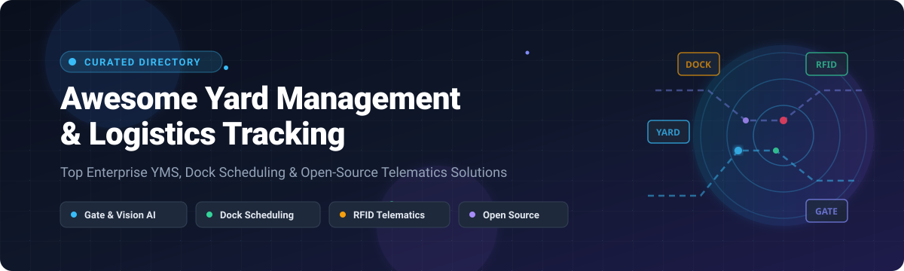

  

  
  
  
  
  
  

# 🚚 Awesome Yard Management & Logistics Tracking 🌐

> 🌟 **A comprehensive, SEO-optimized curated directory of top Yard Management Systems (YMS), Dock Appointment Scheduling platforms, and Logistics Asset Tracking tools** — spanning leading commercial SaaS suites and community open-source implementations for managing trailers, containers, chassis, and railcars across distribution facilities and intermodal terminals.
> 
> ⭐ *Star this repository if you find it valuable for your supply chain tech stack!* ⭐

---

## 📑 Table of Contents
- [🌐 Sector Overview & Market Dynamics](#-sector-overview--market-dynamics)
- [🏢 SaaS & Commercial Hosted Platforms](#-saas--commercial-hosted-platforms)
- [💻 Open-Source Software & Developer Repositories](#-open-source-software--developer-repositories)
- [⚖️ Feature Matrix & Capabilities Breakdown](#️-feature-matrix--capabilities-breakdown)
- [🤝 Contributing](#-contributing)
- [📈 Star History](#-star-history)
- [💖 Support & Sponsorship](#-support--sponsorship)
- [📄 License](#-license)

---

## 🌐 Sector Overview & Market Dynamics

The global Yard Management System (YMS) and Dock Scheduling market is valued at approximately **$2.3 Billion to $4.5 Billion (2024–2025)** and is projected to expand at an accelerating **CAGR of 11.0% to 13.6%** through 2032. 

The industry is **highly fragmented** across niche pure-play YMS innovators, IoT/telematics sensor specialists, and mega supply-chain ERP/WMS/TMS ecosystem giants (such as Manhattan Associates, Blue Yonder, and Descartes). High variability in industry requirements—from temperature-controlled cold chains and high-throughput retail cross-docks to rail intermodal container hubs—sustains a multi-vendor landscape driven by integrations with computer vision, RFID tracking, and real-time shipment ETAs rather than a single winner-take-all monopoly.

---

## 🏢 SaaS & Commercial Hosted Platforms

The following enterprise platforms are cloud-hosted Yard Management Systems and real-time logistics tracking suites. The table below is sorted in descending order by **Company Scale (Market Capitalization / Enterprise Valuation / Annual Revenue)**:

| Platform / Vendor | Company Scale (Valuation / Revenue) 📊 | Specific Starting Tier Pricing 💰 | Free Tier / Free Trial Limits ⏱️ | Key Capabilities & Architecture ⚙️ | Best For 🎯 |
| :--- | :--- | :--- | :--- | :--- | :--- |
| **[Manhattan Active Yard Management](https://www.manh.com/)** | **~$14.2 Billion** market cap (~$1.04B annual revenue) | Starts at **$2,500/month** (enterprise modular packages typically start at $30,000 to $120,000+/year) | **No free trial** (enterprise evaluation access strictly via guided sales demo sandbox) | Cloud-native microservices YMS with live trailer interleaving, automatic short-order stock reconciliation, and automated demurrage penalty alarms. | Enterprise supply chains running Manhattan WMS/TMS seeking unified execution. |
| **[Blue Yonder Yard Management](https://blueyonder.com/)** | **~$8.5 Billion** enterprise valuation ($1.0B+ annual revenue; subsidiary of Panasonic) | Starts at **$8,333/month** (annual deployment contracts scale from ~$100,000/year base to $500,000+/year enterprise suites) | **No free trial** (proof-of-concept pilot requires enterprise contract discovery) | Computer-vision gate automation, Panasonic IoT edge hardware integration, dock door slotting, and end-to-end WMS inventory sync. | Large distribution operations seeking AI computer-vision automated gate entries. |
| **[Descartes Yard Management](https://www.descartes.com/)** | **~$7.6 Billion** market cap (~$572.9M annual revenue) | Starts at **$1,200/month** (dock scheduling add-on tier; core setups average $15,000–$45,000/year) | **No free trial** (guided virtual product walkthrough upon discovery consultation) | Global Logistics Network (GLN) linkage, touch-screen offline guard shack apps, security seal logging, and C-TPAT regulatory audit trail tracking. | Shippers requiring multi-carrier compliance auditing, seal tracking, and security trails. |
| **[project44 Yard Management](https://www.project44.com/)** | **~$2.7 Billion** valuation (~$210M ARR) | Starts at **$2,500/month** (Movement platform basic tier; enterprise packages start from $30,000–$72,000/year) | **No free trial** for enterprise YMS (Carrier tools like DriveView offer free lifetime carrier accounts) | Real-time trailer & container visibility via active RFID tags, SKU-level asset tracking, carrier self-service appointment scheduling, and automated kiosk check-in. | High-throughput logistics nodes requiring SKU-level container tracking and RFID tags. |
| **[FourKites Dynamic Yard](https://www.fourkites.com/)** | **~$1.0 Billion** valuation (~$115M ARR) | Starts at **$1,500/month** (entry visibility deployment; full enterprise installations average $25,000–$60,000+/year) | **No free trial** (complimentary interactive live platform simulation provided on demo request) | Predictive in-transit GPS ETAs linked directly to yard spotter assignments, gate bottleneck analytics, and dynamic dock appointment rescheduling. | Enterprise shippers wanting real-time in-transit ETAs synchronized with yard crew tasks. |
| **[Kaleris Yard & Transload (PINC)](https://kaleris.com/)** | **~$80 Million** estimated annual revenue | Starts at **$1,800/month** (per-site baseline; multi-facility terminal contracts scale from $25,000 to $80,000+/year) | **No free trial** (assisted interactive terminal demo provided by technical sales team) | Combines PINC's Digital Yard IoT sensor mesh (RFID, optical cameras, drones) with specialized AEI railcar tag readers, switch requests, and scale transloading. | Intermodal rail terminals, bulk transload yards, and sensor-dense industrial campuses. |
| **[C3 Solutions (C3 Yard & Hive)](https://www.c3solutions.com/)** | **~$5.0 Million** estimated annual revenue | Starts at **$1,000/month** (dock slotting base; full C3 Yard configurations start from $15,000 to $35,000/year plus one-time setup) | **No free trial** (custom interactive workflow demonstration provided for qualified facilities) | Vision AI optical gate cameras analyzing up to 25 data points (DOT numbers, license plates, trailer IDs), QR-code mobile driver check-in, and C3 Hive cross-party sync. | High-volume retail distribution centers seeking vision AI gate check-in automation. |
| **[YardView](https://yardview.com/)** | **~$1.9 Million** estimated annual revenue (acquired by Vector) | Starts at **$900/month** (flat facility subscription tier with unlimited system users) | **No free trial** (personalized software live demonstration and sandbox trial upon qualification) | Purpose-built YMS established in 1998; features driver in-cab smart tablet client, algorithmic "Next-Best Move" tasking, automated SMS alerts for OTR drivers, and detention control. | Mid-market distribution hubs seeking dedicated, fast-deployment YMS software. |

---

## 💻 Open-Source Software & Developer Repositories

The following self-hosted and open-source projects provide developer frameworks, simulation algorithms, interactive applications, and APIs for yard control, container stacking, and dock scheduling. Repositories are sorted in descending order by **GitHub Stars_Count**:

| Repository / Tool | Stars_Count Badge 🌟 | Stack / Technologies 🛠️ | License 📜 | Description & Key Features 💡 |
| :--- | :--- | :--- | :--- | :--- |
| **[YardMaster](https://github.com/apexpre-dator/YardMaster)** |  | Python, JavaScript | MIT | Open yard management system designed to streamline distribution yard movements, optimize trailer staging spots, and automate check-in inspection tasks. |
| **[TrainTracker](https://github.com/vega670/TrainTracker)** |  | JavaScript, Web | GPL-3.0 | RailServe railcar yard management application tracking track assignments, rail switch sequences, transload states, and rail inventory. |
| **[YardManagementSystem (React/ASP.NET)](https://github.com/nirjalashrestha/YardManagementSystem)** |  | React, ASP.NET Core, C# | MIT | Web-based Yard Management System providing gate transactions, dock assignment scheduling, spotter movement logs, and interactive yard mapping. |
| **[CYMS (Container Yard Management)](https://github.com/joloortiz/CYMS)** |  | PHP, MySQL, JavaScript | MIT | Container Yard Management System focused on port terminal operations, tracking TEU storage positions, bay-row-tier allocations, and gate equipment interchange receipts. |
| **[YardManagementSystem (BitShift HackOut)](https://github.com/rahilmavani/YardManagementSystem)** |  | Python, Flask, HTML5 | MIT | Algorithmic yard management prototype built for optimal container placement, minimizing yard reshuffle steps and container crane travel distance. |
| **[GPlanSiS | YARD](https://github.com/SSBianchiplan/yard)** |  | FastAPI, React 19, PostgreSQL | Apache-2.0 | Full industrial Yard Operating System featuring LPR/QR/RFID gate automation, finite-capacity dock scheduling, anti-fraud weighing scales, and AI-assisted spotter task dispatch. |
| **[Loadsmart API Profile](https://github.com/api-evangelist/loadsmart)** |  | OpenAPI Specification | CC-BY-4.0 | OpenAPI surface documentation and metadata profile detailing digital freight matching, warehouse dock check-in, and automated appointment scheduling endpoints. |
| **[Terminal YOS API Profile](https://github.com/api-evangelist/terminal-logistics)** |  | OpenAPI Specification | CC-BY-4.0 | Public API schema for Terminal Industries' AI-native Yard Operating System (YOS), enabling computer vision integrations and gate telematics ingestion. |
| **[FreightRoll YardOS API Profile](https://github.com/api-evangelist/freightroll)** |  | OpenAPI Specification | CC-BY-4.0 | API architectural profile for FreightRoll YardOS, standardizing driver paperless e-manifest check-ins, trailer staging coordinates, and spotter commands. |
| **[Stellplatzdisposition Demo](https://github.com/sebastian-hanisch/hofstellplatz-demo)** |  | Python, Streamlit | MIT | Interactive Streamlit algorithmic demonstrator modeling swap-body (Wechselbrücken) placement into nested yard rows to minimize re-handling moves. |
| **[Hof-Disposition Robuste Demo](https://github.com/sebastian-hanisch/hofrobust-demo)** |  | Python, Streamlit | MIT | Yard vehicle dispatch simulator evaluating operational resilience against spotter truck breakdowns and variable internal transit delays. |
| **[Yard-Demo Fahraufträge](https://github.com/sebastian-hanisch/yard-demo)** |  | Python, Streamlit | MIT | Swap-body movement task simulator optimizing tractor-trailer dispatching sequences between yard holding bays and active warehouse dock doors. |

---

## ⚖️ Feature Matrix & Capabilities Breakdown

| Software / Solution | Deployment Model ☁️ | Gate Check-in Automation 🚪 | Dock Scheduling ⏰ | Asset Telematics / Sensor Support 📡 | Real-Time Optimization Engine 🧠 | Primary Industry Target 🎯 |
| :--- | :--- | :--- | :--- | :--- | :--- | :--- |
| **Manhattan Active YM** | Cloud-Native SaaS | RFID, Barcode, Kiosk | Inbound & Outbound Sync | GPS, Telematics, RFID | Live Trailer Interleaving | Multi-facility enterprise retail & CPG |
| **Blue Yonder YM** | Cloud-Native SaaS | Vision AI & OCR Cameras | Automated Door Assignment | Panasonic Edge IoT, RFID | Dynamic Task Prioritization | Mega-DCs, 3PL logistics networks |
| **Descartes YM** | Cloud / Mobile Hybrid | Guard Kiosk & Tablets | Global Logistics Net Sync | Security Seal IoT, Barcode | Compliance & Audit Trail Engine | Regulated cargo, food, chemical, automotive |
| **project44 Yard** | Cloud SaaS | Self-Service Kiosks | Carrier Collaborative Portal | Active RFID & BLE Beacons | Predictive ETA Inbound Alignment | Shippers requiring granular SKU-to-trailer mapping |
| **FourKites Dynamic Yard** | Cloud SaaS | Guard App, Tablet, Geofence | Dynamic ETA Door Slotting | Telematics, Cellular GPS | Machine Learning Detention Forecaster | Visibility-driven global freight operations |
| **Kaleris Yard & Transload** | Cloud SaaS & Mobile | AEI Scanners & Gate Kiosks | Rail Track & Dock Slotting | AEI, Optical, RFID, Drone Mesh | Terminal Yard Intelligence Suite (YIS) | Intermodal rail terminals, bulk liquid, transload |
| **C3 Solutions** | Cloud SaaS | Vision AI (25 data points) | C3 Reservations Portal | Optical OCR, QR/PIN Code | Real-time Congestion Balancer | Retail distribution centers & grocery hubs |
| **YardView** | Cloud SaaS | Guard Portal & SMS Link | Standard Dock Calendar | GPS Beacon, Barcode Scan | In-Cab "Next-Best Move" Routing Engine | Mid-sized dedicated manufacturing & warehousing yards |
| **GPlanSiS \| YARD** | Self-Hosted Open-Source | LPR / QR / RFID Gates | Finite Dock Capacity Rules | Weighbridge Scale Anti-Fraud | Human-in-the-Loop AI Dispatch Assistant | Industrial plants, self-hosted distribution centers |
| **YardMaster** | Self-Hosted Open-Source | Web Gate Form | Basic Dock Slots | Manual / Barcode Entry | Heuristic Trailer Placement | Developer prototypes, regional logistics yards |
| **TrainTracker** | Self-Hosted Open-Source | Yard Master Switch Board | Rail Track Siding Rules | Railcar AEI & Car Numbers | Switch Sequence Logic | Rail yards, manufacturing sidings |

---

## 🤝 Contributing

Contributions are welcomed and deeply appreciated! If you have developed or discovered an open-source yard management tool, logistics tracker, or dock scheduling project, please submit a pull request:

1. 🍴 **Fork** the repository
2. 🌿 **Create a feature branch**: `git checkout -b feature/add-new-yms-tool`
3. 📝 **Add your entry** to the appropriate table (including live Stars_Counts, links, licenses, and concise overviews)
4. 📬 **Submit a Pull Request** with a brief summary of why the tool is beneficial to the supply chain community.

---

## 📈 Star History

---

## 💖 Support & Sponsorship

Thank you for exploring and utilizing **Awesome Yard Management & Logistics Tracking**! 🚛📦

If this curated guide assists your supply chain projects, system evaluations, or engineering architecture:
- ⭐ **Star** this repository to help other supply chain practitioners discover it
- 🍴 **Fork** it to keep a personal reference and contribute back
- 📢 **Share** it across LinkedIn, Twitter/X, and logistics developer channels
- ☕ **Support the maintainer**: You can buy me a coffee and sponsor ongoing updates through the [GitHub Sponsor Dashboard](https://github.com/sponsors/ishandutta2007). Your generosity powers continual research and curation!

---

## 📄 License

This repository is made available under the [Creative Commons Zero v1.0 Universal](LICENSE) (CC0 1.0 - Public Domain Dedication).  
*All product names, logos, trademarks, and registered trademarks belong to their respective commercial and open-source owners.*
